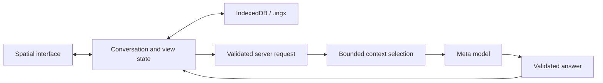

# Architecture

Current implementation · 2026-11-04

One Next.js app uses React and TypeScript for the interface and a server route
for the Meta Model API. A Three.js `PerspectiveCamera` projects HTML topics and
SVG connections. Text remains selectable and scrolls natively; there is no WebGL
background. A 2D canvas draws stars through the same camera.

The starfield has varied sizes and brightness, slow depth drift, slight twinkle,
a cached faint galaxy, and a shooting star every 12–24 visible seconds. Ambient
redraws are capped at 30 fps and only update the canvas; text and connections stay
still. Hidden tabs pause animation, and reduced motion disables ambient movement.

Topics remain mounted while the camera moves. Projected scale selects titles,
summaries, or full answers. The app owns layout, draggable positions, source
arrows, the navigation rail, and section outlines.

A new-topic event triggers a 1.2-second source-to-detail transition: pull back,
reveal the child and connection, then enter the answer. It does not replay when
loading a saved conversation or continuing an existing topic. User navigation,
typing, or selection interrupts it. Answers arriving after another interaction
can reveal their new node without taking over the camera. Reduced motion snaps
to the destination; hidden tabs pause the timeline without catching up on return.

The mini-map projects actual topic coordinates isometrically and supports pointer
and keyboard navigation. Its diamond marks the camera destination, not a live
camera position. This keeps ambient and camera frames out of React state updates.

Ordinary wheel input follows reading and navigation parents. Native answer
scrolling is preserved; wheel input over empty space scrolls the active reader.
At an edge, a gesture gate requires fresh intent after a brief quiet interval,
and permits at most one semantic step per gesture. Reaching an edge while reading
does not immediately move to another topic. Pinch/Ctrl-wheel and explicit zoom
controls retain geometric camera movement.

The reading, child-choice, and overview states are separate. A child-choice view
frames its parent and direct children while keeping other readers mounted and
hidden so their reading positions survive. An HTML chooser keeps titles legible
even in a wide tree. Only `parentId` determines these paths; related links do not.
Return navigation restores saved reading state rather than forcing the parent to
its beginning or end. Scrolling never invokes generation or selects a child from
a multi-child choice automatically.

Automatic positions use stable horizontal lanes within depth rows. Spacing
accounts for perspective to keep fitted overviews from overlapping cards.
Manual positions are applied separately from conversation validation so dragging
does not repeatedly parse the whole conversation. Reset layout clears those
overrides and reframes the overview, preserving text and saved reading state.

## Data model

The current model is nested JSON, not a separate database table for every record.

| Record | Stored fields |
| --- | --- |
| Conversation | ID, title, root ID, explorations keyed by ID, sample/live kind, related connections. |
| Exploration | Title, summary, one parent, source reference, ordered messages, initial position. |
| Message | Role, stable ID, ordered sections; generated messages also retain request ID, source, routing, model, and context record. |
| Section | Stable ID, heading, original Markdown body. |
| Source reference | Exploration, message, starting section, optional ending section and selected quote. |
| Related connection | Two topic IDs, reason, suggested/accepted status. |
| View | Active topic, camera, overview, history, dragged positions, per-topic draft, selection, scroll position, and optional unfinished question. |

Navigation parents form a tree; separate related connections may contain cycles.
Source selections must match rendered text within one assistant message, including
selections across its sections. App-assigned IDs preserve existing answer text.

Text selection first creates a temporary, range-positioned action. Choosing
**Ask about this** commits its validated source reference and focuses the composer.
The preview is not saved or sent. Selection-handle changes are debounced; scroll,
resize, navigation, or dismissal removes the action to avoid a stale screen anchor.

## Answer flow

1. Capture the question, target, selection, placement mode, and explicitly included
   topics under a request ID. Clear the input immediately and show the submitted
   question in its topic's pending card. A newly typed draft stays separate.
   Navigation does not change the captured target.
2. Validate the request on the server. Preserve the current selection and original
   question. Reserve up to 20,000 characters for at most 12 genuine source
   anchors, nearest topic first, before adding recent message excerpts and other
   topic summaries. This keeps older origins available after the parent grows.
   The total budget is 60,000 characters, not a token-count guarantee. Shortened
   or omitted anchors are flagged; stored history remains intact.
3. Ask `muse-spark-1.3` for structured sections, placement advice, and optional
   related-topic suggestions. Validate output before applying it. The interface
   always requests automatic placement; the first answer continues the empty
   root. Explicit API modes remain supported for file/tool compatibility.
4. Append immutably with app-assigned IDs. Applying an already completed request
   ID does not duplicate its answer. A network retry can still incur another model
   call. A selected passage retains its exact source. Without a selection, a
   separate topic connects to its parent without inventing a section source.
   Continued answers refresh the topic summary while retaining its stable title.

Context records identify topics sent with message excerpts versus summaries and
flag truncation. The `fullIds` field can include shortened excerpts or source anchors;
it does not guarantee every historical word was sent. Accepted links are not
automatically full context: the user chooses topics to include.

The key stays in server environment variables. Requests and model output are
validated; timeouts and errors preserve the question for retry. Answers are
returned whole, without streaming. Browsing and model-requested retrieval are
not implemented.

## Persistence and `.ingx`

`.ingx` means Interactive Navigation Graph x. Version 1 is UTF-8 JSON containing
`format`, `version`, `savedAt`, `conversation`, and `view`. Import validates a
2 MiB size limit, allowed fields, counts, text limits, finite coordinates, unique
IDs, references, quotes, and parent cycles. Imported spaces receive a new
conversation ID, preserving the existing library. Credentials are not exported.

Optional `view.pending` records the request ID, target topic, question, selected
passage, and included topic IDs. It does not duplicate the conversation or store
credentials. Reloading or importing restores it as paused; sending requires an
explicit retry. Stop preserves it, while Dismiss removes it without changing the
next draft. A completed request ID cannot also appear as pending. Files without
this optional field still load; older strict readers may reject files containing
it.

IndexedDB stores snapshots by conversation ID. A synchronous localStorage backup
protects recent state when the page is hidden or closed and provides a fallback
when IndexedDB is unavailable. Loading chooses the newer copy; serialized writes
avoid older autosaves overwriting a newer backup. Storage failures are reported,
and old conversations are not silently evicted. Browser storage can still be
cleared or unavailable; exported files provide a separate copy.

## Verification and release

Automated checks cover model validation, routing, context, persistence, and UI
state. A three-request localhost smoke test verified live root, branch, and
continuation behavior. Visual acceptance is pending because the browser bridge
was unavailable; no public deployment has been verified.

Submission deadline supplied by the organizer: November 4, 2026, 21:00 ET
(November 5, 02:00 UTC). Keep the [release checklist](hackathon.md),
[deployment instructions](deployment.md), and [demo](demo.md) separate from
implementation status.
