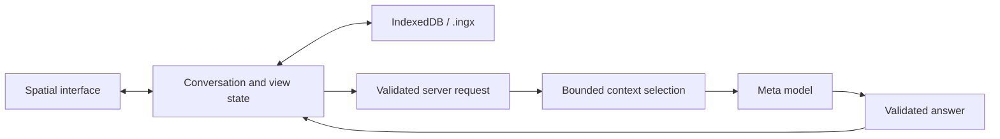

# Architecture

Current implementation · 2026-11-04

One Next.js app uses React and TypeScript for the interface and a server route
for the Meta Model API. A Three.js `PerspectiveCamera` projects HTML topics and
SVG connections. Text remains selectable and scrolls natively; there is no WebGL
background. A 2D canvas draws stars through the same camera.

The starfield drifts slowly at different depths, with a faint shooting star every
20–40 visible seconds. Ambient redraws are capped at 30 fps and only update the
canvas; text and connections stay still. Hidden tabs pause animation, and reduced
motion disables ambient movement.

Topics remain mounted while the camera moves. Projected scale selects titles,
summaries, or full answers. The app owns layout, draggable positions, source
arrows, the navigation rail, and section outlines.

## Data model

The current model is nested JSON, not a separate database table for every record.

| Record | Stored fields |
| --- | --- |
| Conversation | ID, title, root ID, explorations keyed by ID, sample/live kind, related connections. |
| Exploration | Title, summary, one parent, source reference, ordered messages, initial position. |
| Message | Role, stable ID, ordered sections; generated messages also retain request ID, source, routing, model, and context record. |
| Section | Stable ID, heading, original Markdown body. |
| Source reference | Exploration, message, starting section, optional ending section and selected quote. |
| Related connection | Two topic IDs, reason, suggested/accepted status. |
| View | Active topic, camera, overview, history, dragged positions, per-topic draft, selection, and scroll position. |

Navigation parents form a tree; separate related connections may contain cycles.
Source selections must match rendered text within one assistant message, including
selections across its sections. App-assigned IDs preserve existing answer text.

## Answer flow

1. Capture the question, target, selection, placement mode, and explicitly included
   topics under a request ID. Navigation does not change that target.
2. Validate the request on the server. Build context from the original question,
   selected passage, current topic, included topics, and ancestors, then add other
   topic summaries within a 60,000-character budget. This is a character budget,
   not a token-count guarantee. Stored history remains intact.
3. Ask `muse-spark-1.3` for structured sections, placement advice, and optional
   related-topic suggestions. Validate output before applying it. Forced placement
   wins; the first answer continues the empty root.
4. Append immutably with app-assigned IDs. Applying an already completed request
   ID does not duplicate its answer. A network retry can still incur another model
   call. The latest placement can be changed locally without regenerating text.

Context records identify topics sent with message excerpts versus summaries and
flag truncation. The `fullIds` field can include shortened message excerpts;
it does not guarantee every historical word was sent. Accepted links are not
automatically full context: the user chooses topics to include.

The key stays in server environment variables. Requests and model output are
validated; timeouts and errors preserve the question for retry. Answers are
returned whole, without streaming. Browsing and model-requested retrieval are
not implemented.

## Persistence and `.ingx`

`.ingx` means Interactive Navigation Graph x. Version 1 is UTF-8 JSON containing
`format`, `version`, `savedAt`, `conversation`, and `view`. Import validates a
2 MiB size limit, allowed fields, counts, text limits, finite coordinates, unique
IDs, references, quotes, and parent cycles. Imported spaces receive a new
conversation ID, preserving the existing library. Credentials are not exported.

IndexedDB stores snapshots by conversation ID. A synchronous localStorage backup
protects recent state when the page is hidden or closed and provides a fallback
when IndexedDB is unavailable. Loading chooses the newer copy; serialized writes
avoid older autosaves overwriting a newer backup. Storage failures are reported,
and old conversations are not silently evicted. Browser storage can still be
cleared or unavailable; exported files provide a separate copy.

## Verification and release

Automated checks cover model validation, routing, context, persistence, and UI
state. A three-request localhost smoke test verified live root, branch, and
continuation behavior. Visual acceptance is pending because the browser bridge
was unavailable; no public deployment has been verified.

Submission deadline supplied by the organizer: November 4, 2026, 21:00 ET
(November 5, 02:00 UTC). Keep the [release checklist](hackathon.md),
[deployment instructions](deployment.md), and [demo](demo.md) separate from
implementation status.
