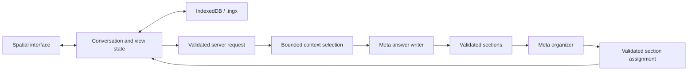

# Architecture

Current implementation · 2026-11-05

One Next.js app uses React and TypeScript for the interface and a server route
for the Meta Model API. A Three.js `PerspectiveCamera` projects HTML topics and
SVG connections. Text remains selectable and scrolls natively; there is no WebGL
background. A 2D canvas draws stars through the same camera.

The starfield has varied sizes and brightness, slow depth drift, slight twinkle,
a cached faint galaxy, and a shooting star every 12–24 visible seconds. Ambient
redraws are capped at 30 fps and only update the canvas; text and connections stay
still. Hidden tabs pause animation, and reduced motion disables ambient movement.

Topics remain mounted while the camera moves. Projected scale selects titles,
summaries, or full answers. The app owns layout, draggable positions, source
arrows, the navigation rail, and section outlines. A focused source/reply pair uses temporary presentation
coordinates on wide screens: the source stays in place and the reply appears to
its left. Small screens focus the reply with its source reference. This does not
alter saved manual positions. Explicit full-detail IDs keep both readers open;
the current pair and camera survive reload.

A new-topic event triggers a 1.2-second source-to-detail transition: pull back,
reveal the child and connection, then enter the answer. It does not replay when
loading a saved conversation or continuing an existing topic. User navigation,
typing, or selection interrupts it. Answers arriving after another interaction
can reveal their new node without taking over the camera. Reduced motion snaps
to the destination; hidden tabs pause the timeline without catching up on return.

When several subjects arrive together, new topics fan out into a fitted choice
view instead of entering an arbitrary first answer. Reused topics remain in place.
The choice can include affected topics under different parents, their paths,
and synthesis inputs. A single organized destination opens directly for reading.
User interaction prevents camera takeover; loading saved work does not replay
arrivals. **Open answer** remains available when a reply arrives elsewhere.

The **Conversation map** projects actual topic coordinates isometrically and
supports pointer and keyboard navigation. Hover or focus previews a topic title;
activation jumps to it. Pointer selection uses the nearest actual dot within its
hit radius, accounting for SVG scaling and letterboxing, so overlapping hit areas
do not select whichever node was painted last. Its diamond marks the camera
destination, not a live camera position. This keeps ambient and camera frames out
of React state updates.

Wheel ownership follows the pointer. Full topic readers keep native scrolling;
wheel input over their headers or padding scrolls that topic's reader. A topic
edge never changes the camera. Empty-space wheel input navigates the hierarchy:
up goes to the parent (or from the root to the overview), down opens one child or
frames several child choices. Down in a choice leaves the decision to the user;
up returns to its parent reader. Down from the overview resumes the active reader,
and a compact focused topic is centered before descending further.

`advanceSpatialScroll` allows one navigation step after 70px of accumulated wheel
movement, then consumes the rest of the burst. A 200ms pause starts a new burst.
Topic-started gestures, pointer crossings into a topic, and scope changes consume
the remaining gesture; moving back into empty space cannot convert reading
momentum into navigation. Pinch/Ctrl-wheel and explicit zoom controls retain
geometric camera movement. Reading input cancels pending automatic answer following.

The reading, child-choice, and overview states are separate. A child-choice view
frames its parent and direct children while keeping other readers mounted and
hidden so their reading positions survive. Choice and overview cards stay compact;
their title buttons are the navigation targets, without a separate chooser panel.
Arrow keys move among choice titles; Enter opens one and transfers focus to its
reader once visible. Only `parentId` determines hierarchy paths; related links do
not. Back retraces visit history; breadcrumbs follow ancestry. Returning restores
saved reading state. Visible controls also move up to the parent, explore deeper
topics, or return from the overview to reading. **Asking about** names the active
topic above the composer. Follow-up links appear beside their originating
sections, including every covered section of a multi-section selection.

Normal focus uses canonical graph coordinates and one reader; explicit passage
links may use temporary source/reply positions. Source visits wait for a readable
card before aligning the passage and do not modify composer selection. Outlines
collapse before measuring their target; card headers reserve their actual height.

Automatic positions use stable, compact sibling slots: four siblings form a
small grid, and later topics take available slots without moving earlier topics.
A synthesis topic is placed below its contributing inputs while retaining one
navigation parent. Manual positions are applied separately from conversation
validation, so dragging does not repeatedly parse conversation text. Reset layout
clears those overrides and reframes the overview, preserving reading state.

## Data model

The current model is nested JSON, not a separate database table for every record.

| Record | Stored fields |
| --- | --- |
| Conversation | ID, title, root ID, explorations keyed by ID, sample/live kind, related and synthesis connections. |
| Exploration | Title, summary, one parent, source reference, ordered messages, initial position. |
| Message | Role, stable ID, ordered sections; generated messages retain source, routing, model, and context; the primary answer carries the request completion ID. |
| Section | Stable ID, heading, original Markdown body. |
| Source reference | Exploration, message, starting section, optional ending section and selected quote. |
| Connection | Source and destination IDs, reason, type (`related` or `synthesis`), suggested/accepted status. Synthesis edges are directed and accepted. |
| View | Active topic, camera, overview, history, dragged positions, per-topic draft, selection, annotation queue, scroll position, optional source/reply view, and unfinished question. |

Navigation parents form a tree; the separate connection graph may contain cycles.
Source selections must match rendered text within one assistant message, including
selections across its sections. Within a topic, a message source must precede its
reply; message-source chains cannot contain cycles across topics either. A later
reply can revisit a topic without creating a circular message dependency.
App-assigned IDs preserve existing answer text.

Text selection first creates a temporary, range-positioned action. Choosing
**Ask about this** opens a small editor beside that passage, with independent
question text stored in the annotation queue. The normal prompt stays unchanged.
The editor follows the source while scrolling and fits the visual viewport.
**Add another annotation** or closing the editor retains the draft; selecting
another passage opens its own editor. Source markers and the compact draft tray
reopen annotations for editing. Local Send submits the queue with separate IDs,
sources, and questions, including a single annotation. Only submitted drafts are
cleared. Editing a draft from another topic reveals its source without changing
draft ownership; narrow layouts prioritize the source. This temporary editing
view is not serialized as a source/reply relationship.
Older files with a selection and prompt draft still offer Resume annotation
and keep the legacy selection request. The preview is not saved or sent.
Selection-handle changes are debounced; scroll,
resize, navigation, or dismissal removes the action to avoid a stale screen anchor.

## Answer flow

1. Capture the question, target, selection or annotation batch, placement mode, and explicitly included
   topics under a request ID. Clear the input immediately and show the submitted
   question in its topic's pending card. A global **Thinking…** status, pulsing orb,
   and Stop action remain visible while navigating elsewhere. Completion, failure,
   or cancellation clears that waiting status. A newly typed draft stays separate.
   Navigation does not change the captured target. Paused questions expose
   **View question**, **Retry**, and **Dismiss** outside the originating card.
2. Build bounded context from the selection, original question, genuine source
   anchors, recent excerpts, and summaries. Reserve up to 20,000 characters for
   at most 12 source anchors. Annotation source paths precede an unrelated active
   path. Prioritize annotated sources, the active topic, explicitly included
   topics, and accepted synthesis contributors, followed by ancestors, retrieved
   topics, and up to eight direct children. Contributor expansion follows one hop
   from the active/annotation paths and explicitly included topics, adding at most
   16 topics; it does not recurse through the graph. Unrelated siblings do not
   automatically receive full excerpts. Topics and summaries carry `parentId`.
   The total JSON budget is 60,000 characters, not a token-count guarantee.
3. Call `muse-spark-1.3` as the answer writer. It produces validated Markdown
   sections and may suggest grouping or synthesis sources. Brief shortlists can
   stay inline; substantial independent subjects can have separate answers.
   Multiple headings about one subject do not require multiple topics.
4. Call the same model as an organizer, with the question, supplied topic
   directory, and exact writer sections. It assigns each section ID exactly once,
   in original order within its group. It may write titles, summaries, a short
   placement reason, and an overview; it cannot rewrite substantive section text.
   Both calls receive resolved selected text and each annotation's own question.
   An unanswered root is explicitly marked as the first answer so both models
   establish its subject title. If the organizer repeats the initial label, keep
   the writer's title; if both repeat it, use the bounded question. Later replies
   retain the established title.
   Selection defines pronoun scope; wider history only helps interpret it. Detailed
   independent subjects need separate writer sections for the organizer to assign.
   Validate complete coverage, unique assignments, supplied targets, and bounds.
5. Apply the complete result atomically. There can be at most eight additional
   topic outputs and 40,000 serialized section characters across the answer.
   With additional outputs, the primary response continues the active topic as
   an overview of at most two sections and 4,000 serialized characters. A target
   can be an existing topic to continue or an existing parent for a new topic;
   outputs cannot target another node newly created in the same batch.
6. A new synthesis branches into a topic with two to eight unique supplied
   `sourceIds`. Add accepted, directed input-to-synthesis edges and retain every
   original topic. An existing synthesis can continue using its already accepted
   inputs without duplicating edges; changing contributors requires a new
   synthesis. Synthesis edges do not change navigation ancestry. Continuing an
   existing topic refreshes its summary and retains its established title.

A batch accepts up to six annotations, with up to 8,000 characters per question,
24,000 question characters in total, and 24,000 resolved passage characters.
Every annotation requires exactly one topic output bearing the same ID. The
organizer cannot move its writer sections to another annotation or the overview.
A new annotated reply branches from its actual source; an existing dedicated
subject topic may be reused. Each reply stores its individual question and exact
source. Invalid or incomplete batches are rejected without partial changes.

The interface requests automatic placement. Explicit API modes remain supported
for compatibility and reject additional outputs. Organizer decisions are model
judgments; structural validation does not guarantee ideal semantic grouping.
Existing saved answers are not automatically repartitioned or converted.

The app assigns IDs. Only the primary answer carries the completion receipt;
additional messages have deterministic IDs. Reapplying a completed request returns
all its destinations without duplicating content. A network retry can still repeat
both paid calls. Invalid plans leave the conversation unchanged.

Selected passages remain exact message sources. A new topic's passage source is
set only when it belongs to that topic's navigation parent; a cross-topic request
keeps its source on the messages without inventing a parent passage.

Context records distinguish excerpts from summaries and flag truncation.
Original user requests and later corrections have a separate bounded allocation
across source paths, included topics, contributors, and retrieved topics before
assistant histories consume space. Entries retain their topic and message IDs;
identical wording in separate topics or after a correction is preserved. Only the
root prompt already supplied as `originalQuestion` is excluded from this list.
The model interprets local scope and which later corrections supersede earlier
requirements; text equality alone does not remove a requirement.
Generic lexical relevance ranks distant topics and retrieves up to three related
bodies. This is bounded retrieval, not a guarantee that every relevant topic fits.
Creation sources and later message sources both expose forward reply links;
multi-section selections link from every covered section without duplicating a topic.
`fullIds` may include shortened excerpts or source anchors; it does not mean all
historical text was read. Related or synthesis links alone do not include every
word of their inputs. Explicit inclusion and direct-child selection still obey
the shared context budget.

The route applies one 55-second deadline across upload, context preparation,
writer, and organizer, within its 60-second host limit. Upload also has a separate
10-second deadline. Cancellation propagates to both sequential model calls and
response-body reads. Keys remain in server environment variables. Errors preserve
the question for retry. Answers arrive whole; streaming, browsing, and
model-requested retrieval are not implemented.

## Persistence and `.ingx`

`.ingx` means Interactive Navigation Graph x. Version 1 is UTF-8 JSON containing
`format`, `version`, `savedAt`, `conversation`, and `view`. Import validates a
2 MiB size limit, allowed fields, counts, text limits, finite coordinates, unique
IDs, references, quotes, parent cycles, and message-source chronology and cycles.
Imported spaces receive a new conversation ID, preserving the existing library.
Credentials are not exported.

Optional `view.pending` records the request ID, target topic, question, selected
passage or annotation batch, and included topic IDs. It does not duplicate the conversation or store
credentials. Reloading or importing restores it as paused; sending requires an
explicit retry. Stop preserves it, while Dismiss removes it without changing the
next draft. A completed request ID cannot also appear as pending. Files without
this optional field still load. Older strict readers may reject the pending
fields, annotation queues, paired views, or the synthesis connection type.

IndexedDB stores snapshots by conversation ID. A synchronous localStorage backup
protects recent state when the page is hidden or closed and provides a fallback
when IndexedDB is unavailable. Loading chooses the newer intact copy and can
recover from the other backend if a copy is unreadable or has a mismatched ID.
IndexedDB compares timestamps and updates the snapshot and library in one
transaction; serialized writes also protect newer emergency backups from older
autosaves. Damaged library entries do not hide intact chats: the library reports
a warning, and damaged raw records are retained. A save uses the other backend
when possible; if neither is usable, it reports an error and offers export.

Edit a given conversation in one tab at a time. There is no cross-tab merge or
revision-conflict handling: stale content saved later from another tab can still
replace current work. Old conversations are not silently evicted, but browser
storage can be cleared or unavailable; exported files provide a separate copy.

The rename to metafor preserves the original browser storage identifiers and
`.ingx` version, so existing conversations remain readable.

## Verification and release

Automated checks cover model validation, routing, context, persistence, and UI
state. The latest localhost graph check passed four app requests / eight model
calls: an inline shortlist, four separate city topics, three continuations in
relevant existing city topics, and a new seven-day itinerary with four incoming
synthesis edges. Replay and `.ingx` round trips passed. These are observed outcomes,
not guaranteed routing rules. The annotation regression added three app requests /
six model calls: a Wydad-only selected follow-up, two separately annotated club
questions, and seven country profiles. A further live Safari annotation batch
reused the two existing dedicated club topics. New replies in reused topics are
revealed once when chosen; later visits retain the user's reading position.
Safari also verified the source/reply view and both readers' positions after
refreshing the final production build at port 3002.

Earlier native Safari checks on the local production build at port 3001 verified import
of that graph, the compact four-city layout and synthesis, source-link navigation,
exact reading-position restoration, the section ask action and composer focus,
and the former topic chooser. The final overview was visually checked for compact edges
and redundant origin links. Physical trackpad/touch gestures, device performance,
live arrival motion, and public deployment remain unverified.

Submission deadline supplied by the organizer: November 4, 2026, 21:00 ET
(November 5, 02:00 UTC). Keep the [release checklist](hackathon.md),
[deployment instructions](deployment.md), and [demo](demo.md) separate from
implementation status.
