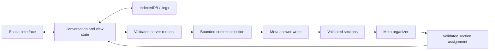

# Architecture

Current implementation · 2026-11-04

One Next.js app uses React and TypeScript for the interface and a server route
for the Meta Model API. A Three.js `PerspectiveCamera` projects HTML topics and
SVG connections. Text remains selectable and scrolls natively; there is no WebGL
background. A 2D canvas draws stars through the same camera.

The starfield has varied sizes and brightness, slow depth drift, slight twinkle,
a cached faint galaxy, and a shooting star every 12–24 visible seconds. Ambient
redraws are capped at 30 fps and only update the canvas; text and connections stay
still. Hidden tabs pause animation, and reduced motion disables ambient movement.

Topics remain mounted while the camera moves. Projected scale selects titles,
summaries, or full answers. The app owns layout, draggable positions, source
arrows, the navigation rail, and section outlines.

A new-topic event triggers a 1.2-second source-to-detail transition: pull back,
reveal the child and connection, then enter the answer. It does not replay when
loading a saved conversation or continuing an existing topic. User navigation,
typing, or selection interrupts it. Answers arriving after another interaction
can reveal their new node without taking over the camera. Reduced motion snaps
to the destination; hidden tabs pause the timeline without catching up on return.

When several subjects arrive together, new topics fan out into a fitted choice
view instead of entering an arbitrary first answer. Reused topics remain in place.
The choice can include affected topics under different parents, their paths,
and synthesis inputs. User interaction prevents camera takeover; loading saved
work does not replay arrivals.

The mini-map projects actual topic coordinates isometrically and supports pointer
and keyboard navigation. Its diamond marks the camera destination, not a live
camera position. This keeps ambient and camera frames out of React state updates.

Ordinary wheel input follows reading and navigation parents. Native answer
scrolling is preserved; wheel input over empty space scrolls the active reader.
At an edge, a gesture gate requires fresh intent after a brief quiet interval,
and permits at most one semantic step per gesture. Reaching an edge while reading
does not immediately move to another topic. Pinch/Ctrl-wheel and explicit zoom
controls retain geometric camera movement.

The reading, child-choice, and overview states are separate. A child-choice view
frames its parent and direct children while keeping other readers mounted and
hidden so their reading positions survive. An HTML chooser keeps titles legible
even in a wide tree. Only `parentId` determines these paths; related links do not.
Return navigation restores saved reading state rather than forcing the parent to
its beginning or end. Scrolling never invokes generation or selects a child from
a multi-child choice automatically.

Automatic positions use stable, compact sibling slots: four siblings form a
small grid, and later topics take available slots without moving earlier topics.
A synthesis topic is placed below its contributing inputs while retaining one
navigation parent. Manual positions are applied separately from conversation
validation, so dragging does not repeatedly parse conversation text. Reset layout
clears those overrides and reframes the overview, preserving reading state.

## Data model

The current model is nested JSON, not a separate database table for every record.

| Record | Stored fields |
| --- | --- |
| Conversation | ID, title, root ID, explorations keyed by ID, sample/live kind, related and synthesis connections. |
| Exploration | Title, summary, one parent, source reference, ordered messages, initial position. |
| Message | Role, stable ID, ordered sections; generated messages retain source, routing, model, and context; the primary answer carries the request completion ID. |
| Section | Stable ID, heading, original Markdown body. |
| Source reference | Exploration, message, starting section, optional ending section and selected quote. |
| Connection | Source and destination IDs, reason, type (`related` or `synthesis`), suggested/accepted status. Synthesis edges are directed and accepted. |
| View | Active topic, camera, overview, history, dragged positions, per-topic draft, selection, scroll position, and optional unfinished question. |

Navigation parents form a tree; the separate connection graph may contain cycles.
Source selections must match rendered text within one assistant message, including
selections across its sections. App-assigned IDs preserve existing answer text.

Text selection first creates a temporary, range-positioned action. Choosing
**Ask about this** commits its validated source reference and focuses the composer.
The preview is not saved or sent. Selection-handle changes are debounced; scroll,
resize, navigation, or dismissal removes the action to avoid a stale screen anchor.

## Answer flow

1. Capture the question, target, selection, placement mode, and explicitly included
   topics under a request ID. Clear the input immediately and show the submitted
   question in its topic's pending card. A newly typed draft stays separate.
   Navigation does not change the captured target.
2. Build bounded context from the selection, original question, genuine source
   anchors, recent excerpts, and summaries. Reserve up to 20,000 characters for
   at most 12 source anchors. Prioritize the active topic, explicitly included
   topics, ancestors, then up to eight direct children. Unrelated siblings do not
   automatically receive full excerpts. Topics and summaries carry `parentId`.
   The total JSON budget is 60,000 characters, not a token-count guarantee.
3. Call `muse-spark-1.3` as the answer writer. It produces validated Markdown
   sections and may suggest grouping or synthesis sources. Brief shortlists can
   stay inline; substantial independent subjects can have separate answers.
   Multiple headings about one subject do not require multiple topics.
4. Call the same model as an organizer, with the question, supplied topic
   directory, and exact writer sections. It assigns each section ID exactly once,
   in original order within its group. It may write titles, summaries, a short
   placement reason, and an overview; it cannot rewrite substantive section text.
   Validate complete coverage, unique assignments, supplied targets, and bounds.
5. Apply the complete result atomically. There can be at most eight additional
   topic outputs and 40,000 serialized section characters across the answer.
   With additional outputs, the primary response continues the active topic as
   an overview of at most two sections and 4,000 serialized characters. A target
   can be an existing topic to continue or an existing parent for a new topic;
   outputs cannot target another node newly created in the same batch.
6. A synthesis branches into a new topic with two to eight unique supplied
   `sourceIds`. Add accepted, directed input-to-synthesis edges and retain every
   original topic. Synthesis edges do not change navigation ancestry. Continuing
   an existing topic refreshes its summary and retains its established title.

The interface requests automatic placement. Explicit API modes remain supported
for compatibility and reject additional outputs. Organizer decisions are model
judgments; structural validation does not guarantee ideal semantic grouping.
Existing saved answers are not automatically repartitioned or converted.

The app assigns IDs. Only the primary answer carries the completion receipt;
additional messages have deterministic IDs. Reapplying a completed request returns
all its destinations without duplicating content. A network retry can still repeat
both paid calls. Invalid plans leave the conversation unchanged.

Selected passages remain exact message sources. A new topic's passage source is
set only when it belongs to that topic's navigation parent; a cross-topic request
keeps its source on the messages without inventing a parent passage.

Context records distinguish excerpts from summaries and flag truncation.
`fullIds` may include shortened excerpts or source anchors; it does not mean all
historical text was read. Related or synthesis links alone do not include every
word of their inputs. Explicit inclusion and direct-child selection still obey
the shared context budget.

Both sequential model calls share one 55-second timeout and cancellation signal.
Keys remain in server environment variables. Errors preserve the question for
retry. Answers arrive whole; streaming, browsing, and model-requested retrieval
are not implemented.

## Persistence and `.ingx`

`.ingx` means Interactive Navigation Graph x. Version 1 is UTF-8 JSON containing
`format`, `version`, `savedAt`, `conversation`, and `view`. Import validates a
2 MiB size limit, allowed fields, counts, text limits, finite coordinates, unique
IDs, references, quotes, and parent cycles. Imported spaces receive a new
conversation ID, preserving the existing library. Credentials are not exported.

Optional `view.pending` records the request ID, target topic, question, selected
passage, and included topic IDs. It does not duplicate the conversation or store
credentials. Reloading or importing restores it as paused; sending requires an
explicit retry. Stop preserves it, while Dismiss removes it without changing the
next draft. A completed request ID cannot also appear as pending. Files without
this optional field still load. Older strict readers may reject the pending
field or the new synthesis connection type.

IndexedDB stores snapshots by conversation ID. A synchronous localStorage backup
protects recent state when the page is hidden or closed and provides a fallback
when IndexedDB is unavailable. Loading chooses the newer copy; serialized writes
avoid older autosaves overwriting a newer backup. Storage failures are reported,
and old conversations are not silently evicted. Browser storage can still be
cleared or unavailable; exported files provide a separate copy.

## Verification and release

Automated checks cover model validation, routing, context, persistence, and UI
state. The latest localhost graph check passed four app requests / eight model
calls: an inline shortlist, four separate city topics, three continuations in
relevant existing city topics, and a new seven-day itinerary with four incoming
synthesis edges. Replay and `.ingx` round trips passed. These are observed outcomes,
not guaranteed routing rules.

Native Safari checks on the local production build at port 3001 verified import
of that graph, the compact four-city layout and synthesis, source-link navigation,
exact reading-position restoration, the section ask action and composer focus,
and the topic chooser. The final overview was visually checked for compact edges
and redundant origin links. Physical trackpad/touch gestures, device performance,
live arrival motion, and public deployment remain unverified.

Submission deadline supplied by the organizer: November 4, 2026, 21:00 ET
(November 5, 02:00 UTC). Keep the [release checklist](hackathon.md),
[deployment instructions](deployment.md), and [demo](demo.md) separate from
implementation status.
